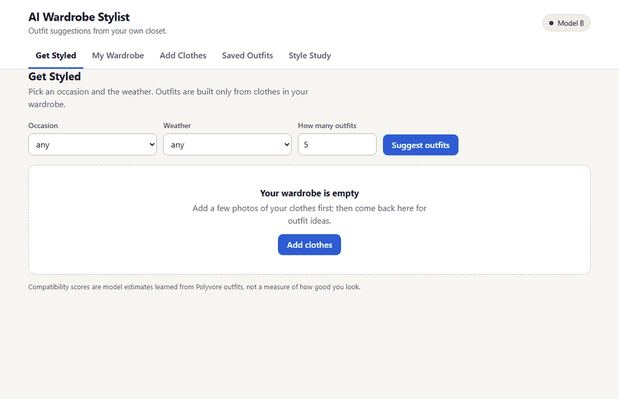
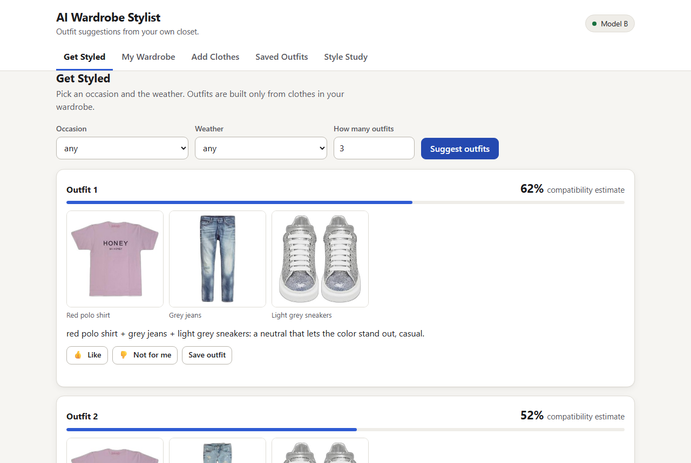
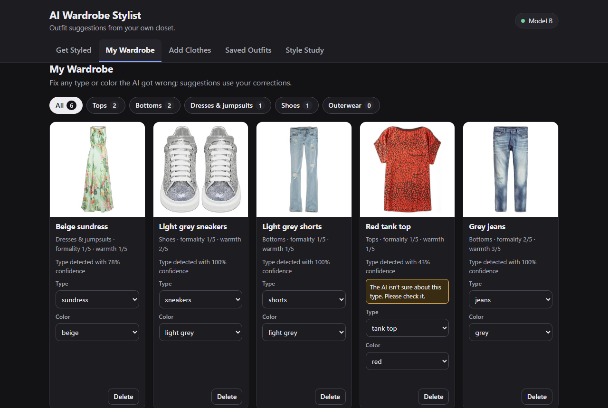
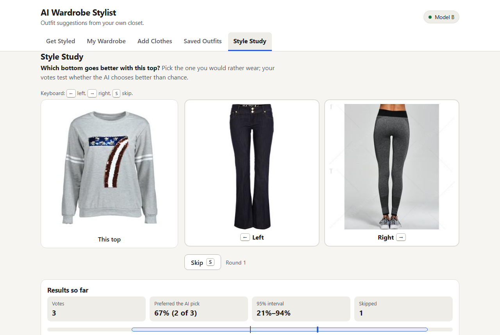

# Project Wardrobe v2

An outfit-compatibility model trained on **Polyvore Outfits**, evaluated on the official
compatibility-AUC and fill-in-the-blank (FITB) benchmarks, and served as a wardrobe app:
upload photos of your clothes and get outfit suggestions for an occasion and the weather, each with an explanation.



| Get Styled | My Wardrobe (dark mode) | Style Study |
|---|---|---|
|  |  |  |

The v1 code is kept in [`legacy/`](legacy/). v1 trained on "top vs. random bottom / other top"
triplets, so it learned to tell categories apart, not compatibility.

## How it works

```
photo ─► rembg (background removed, put on white) ─► FashionCLIP ─► 512-d embedding
                                                         │            │
                                         zero-shot type ◄┘            ▼
                                                         Model A: per-category projector ─► 128-d
                                                                      │
                                         dominant color ─► Model B: pair MLP (+ color features)
                                                                      │
                                                         Platt calibration ─► compatibility %
                                                                      │
                    occasion / weather filters ─► outfit search ─► diversity ─► explanation
```

## Layout

```
configs/config.yaml       all paths and hyperparameters
src/data/polyvore.py      official split, compat and FITB loaders
src/data/prepare.py       Step 1: extract images, build items.csv
src/data/pairs.py         Step 3: positives, random / hard negatives, Dataset
src/features.py           baseline features (color histogram, ResNet50, FashionCLIP)
src/encoder.py            Step 4: FashionCLIP image/text encoder
src/models/compat.py      Step 5: Model A, Model B, triplet / batch-hard losses
src/color.py              dominant color, color names, color-harmony features
src/inference.py          load any trained model as a scorer (eval, calibration, app)
src/eval/                 metrics (AUC, FITB) and batched scoring
src/tagger.py             Step 8: background removal, zero-shot type, color, embedding
src/wardrobe_rules.py     clothing types -> category, formality, warmth
src/recommender.py        Step 9: filters, outfit search (top+bottom or one-piece), diversity, explanations
app/main.py, app/db.py    Step 10: FastAPI + SQLite backend (hardened; optional login)
app/study.py              Step 7: human style study (AI pick vs random pick, Wilson interval)
app/static/               Step 11: frontend (vanilla JS, accessible, light/dark, mobile)
deploy/                   Hugging Face Space instructions
scripts/                  download, baselines, embed, colors, train, calibrate, eval, demo GIF, Space bundle
tests/                    unit, integration (tests/integration) and browser e2e (tests/e2e)
```

## Setup (Windows, NVIDIA GPU)

```powershell
uv venv venv --python 3.11
uv pip install --python venv\Scripts\python.exe torch torchvision --index-url https://download.pytorch.org/whl/cu130
uv pip install --python venv\Scripts\python.exe -r requirements.txt
venv\Scripts\python -c "import torch; print(torch.cuda.is_available())"
venv\Scripts\python -m pytest
```

Exact versions are in `requirements.lock.txt`.

## Pipeline

Polyvore Outfits is gated on Hugging Face. One-time setup: accept the terms at
https://huggingface.co/datasets/mvasil/polyvore-outfits, create a read token at
https://huggingface.co/settings/tokens, then run `venv\Scripts\hf auth login`.

```powershell
# Step 1: data (~1.6 GB for the disjoint split)
venv\Scripts\python -m scripts.download_polyvore
venv\Scripts\python -m src.data.prepare            # data/processed/items.csv, results/data_stats.json

# Step 2: baselines
venv\Scripts\python -m scripts.run_baselines --split test --only random color_hist resnet50 fashion_clip

# Step 4: encoder cache + colors
venv\Scripts\python -m scripts.embed_items         # embeddings.npy + neighbour sanity check
venv\Scripts\python -m scripts.extract_colors

# Step 5: experiments, one change at a time (develop on valid)
venv\Scripts\python -m scripts.train --model A --neg random --overfit 100 --name debug   # loss must go to ~0
venv\Scripts\python -m scripts.train --model A --neg random    --name A_random
venv\Scripts\python -m scripts.train --model A --neg hard      --name A_hard
venv\Scripts\python -m scripts.train --model A --neg batchhard --name A_batchhard      # collapses (see below)
venv\Scripts\python -m scripts.train --model A --neg semihard  --name A_semihard
venv\Scripts\python -m scripts.train --model A --neg hard      --init A_random --lr 1e-4 --name A_random_hard
venv\Scripts\python -m scripts.train --model A --neg semihard  --init A_random --lr 1e-4 --name A_random_semihard
venv\Scripts\python -m scripts.train --model B --base A_random_semihard          --name B
venv\Scripts\python -m scripts.train --model B --base A_random_semihard --color  --name B_color

# Step 6: calibration (fit on valid, report ECE on test)
venv\Scripts\python -m scripts.calibrate --model B

# Step 7: final numbers on test (one row per model in results/comparison.csv)
venv\Scripts\python -m scripts.run_eval --model B --split test

# App
venv\Scripts\uvicorn app.main:app --reload         # http://127.0.0.1:8000  (API docs at /docs)

# Demo GIF (starts its own temp server; your wardrobe is untouched)
venv\Scripts\python -m scripts.make_demo_gif        # results/demo.gif
```

Pick the best Model A by validation AUC for `--base` (here: `A_random_semihard`). The app uses the model named in `config.yaml → app.model`.

## Results (Polyvore Outfits, disjoint split, official test questions)

| Model | Test compat AUC | Test FITB | Notes |
|---|---|---|---|
| Random | 0.495 | 0.257 | chance (FITB has 4 candidates) |
| ResNet50 cosine | 0.578 | 0.338 | generic object features |
| Color histogram cosine | 0.704 | 0.458 | color alone carries a lot |
| FashionCLIP cosine | 0.753 | 0.524 | strong frozen encoder |
| A: random negatives | 0.878 | 0.609 | |
| A: hard negatives (cold start) | 0.854 | 0.572 | worse than random |
| A: batch-hard (cold start) | 0.501 | 0.268 | collapsed: loss stuck at the margin |
| A: semi-hard (cold start) | 0.888 | 0.615 | |
| A: random, then hard | 0.889 | 0.619 | curriculum |
| A: random, then semi-hard | 0.891 | **0.622** | best Model A (by validation) |
| **B: pair scorer on A** | **0.894** | **0.622** | **app model** |
| B + color features | 0.894 | 0.622 | no gain: FashionCLIP already encodes color |

- Calibration (Platt, fit on valid): **test ECE 0.015** on 100k pairs. Reliability plot: `results/reliability_B.png`.
- Recall@10 for "which bottom goes with this top" among 7,695 test bottoms: 1.7% (chance 0.13%).
- Model selection used validation only; the test ranking matches the validation ranking.
- Caveat: the official "disjoint" split still shares 3,790 valid items with train (93 test items),
  so validation scores are slightly optimistic. Test numbers are the ones to report.
- Ablation lessons: hard negatives only help as a second stage after random negatives; pure batch-hard
  from scratch collapses; semi-hard is stable from scratch.

## Evaluation rules

- Use the official **disjoint** splits. Never re-split by item.
- The benchmarks use **all** item categories, so the numbers can be compared with published papers.
  The app uses only tops, bottoms, shoes and outerwear.
- Develop on `valid`. Report on `test` once per final model.
- Calibrators are fit on `valid`, never on `test`.
- Hard negatives skip the closest few neighbours (`--hard-skip`), because those are often equally good matches.

## Progress

- [x] 0. Environment, repo layout, config, seeds, experiment logging
- [x] 1. Polyvore downloaded (152,785 items, 0 invalid), EDA in `results/eda/`
- [x] 2. Metrics and 4 baselines recorded
- [x] 3. Positive, random, hard, batch-hard and semi-hard negatives
- [x] 4. FashionCLIP embeddings cached (neighbour category purity 0.947 vs 0.130 chance)
- [x] 5. Model A (6 negative strategies), Model B, color features
- [x] 6. Calibration (test ECE 0.015)
- [x] 7. Test-set results and ablation table; in-app human style study (votes still to collect)
- [x] 8. Background removal, tagger, color extraction
- [x] 9. Recommender with filters, diversity, explanations
- [x] 10. FastAPI + SQLite, security-hardened, optional login for hosting
- [x] 11. Frontend: 5 tabs, drag-and-drop uploads, editable tags, dresses/jumpsuits, light/dark, mobile, keyboard
- [x] 12. Unit + integration + browser e2e tests, Docker image built and smoke-tested, demo GIF,
      Hugging Face Space bundle (`deploy/HUGGINGFACE.md`; not published)

## Tests

```powershell
venv\Scripts\python -m pytest                    # unit + synthetic end-to-end (~2 min)
venv\Scripts\python -m pytest -m integration     # real data, real tagger, real trained model + study (~1 min)
venv\Scripts\python -m pytest -m e2e             # real browser (Chromium) against a live server (~1 min)
```

## Style study (human evaluation)

The **Style Study** tab shows a random held-out Polyvore top and two bottoms side by side:
- the model's favourite out of 20 random test-set bottoms;
- a random bottom from the same 20.

They appear in random left/right order, and the voter never learns which is which.
`GET /study/results` reports the share of votes for the model's pick, with a 95% Wilson interval.

To run it, ask 15–20 people for about 20 votes each, then report the rate and the interval.
The study needs the Polyvore data, so it is hidden in Docker and Space deployments.

## Docker

```powershell
docker build -t wardrobe:v2 .
docker run -p 127.0.0.1:8000:8000 wardrobe:v2                    # http://localhost:8000
docker run -p 8000:8000 -e WARDROBE_BASIC_AUTH=me:long-password -e WARDROBE_ALLOWED_HOSTS=myhost wardrobe:v2
```

- **Image:** CPU-only, about 3.7 GB, runs as a non-root user.
- **First upload:** downloads FashionCLIP and the background-removal model, which takes about 80 s. Later uploads take under a second.
- **Deployment:** see `deploy/HUGGINGFACE.md`.

## Security

By default there is no login, because the app is meant for `localhost`. For hosting, set
`WARDROBE_BASIC_AUTH="user:password"` to require HTTP Basic auth on every route, including static files and `/docs`.

Hardening in `app/main.py`:
- Host allow-list (DNS rebinding) and exact same-origin check on writes (CSRF).
- Upload limits: 15 MB body cap (enforced before reading; chunked bodies refused), JPEG/PNG/WEBP only,
  40 MP pixel cap checked before decoding (image bombs), server-generated filenames.
- Validated request bounds; 422 errors never echo input back.
- Checkpoints loaded with `weights_only=True`; calibrators are JSON tied to the checkpoint's SHA-256.
- Docker image runs as a non-root user with pinned dependencies.
- At most 2 uploads are decoded/tagged at once (bounded memory under concurrent uploads).
- Strict Content-Security-Policy (same-origin scripts only, no framing) and `nosniff` on every response.
  The frontend never uses `innerHTML`.
- Style study:
  - only held-out test images are served (digit IDs only);
  - rounds are created by POST, so a link or an `` on another site can't create them;
  - one vote per round, enforced atomically;
  - votes cast within 1 s are left out of the results;
  - unvoted rounds are purged after an hour.
- On a Hugging Face Space (`SPACE_ID` is set), the app refuses to start without `WARDROBE_BASIC_AUTH`.
To serve on a LAN, set `WARDROBE_ALLOWED_HOSTS` and understand that anyone on that network can use it.
The same-origin check compares host and port only. That way it keeps working behind TLS-terminating proxies, which rewrite the scheme.
Dependencies are audited with `pip-audit` against `requirements.lock.txt`. PyTorch is at 2.14.1, which fixes CVE-2025-3000.

## Limitations

- Polyvore is mostly women's fashion from about 2017, shot as product images. Phone photos are a different
  domain. Background removal narrows the gap but doesn't close it.
- Formality and warmth come from a per-type lookup table, not from the image.
- Compatibility is learned from what Polyvore users put together, which reflects their taste.
- Zero-shot type tagging can be wrong; the UI lets you correct type and color.
- The style study needs volunteers. The tool and the statistics are ready, but no human votes have been collected yet.
